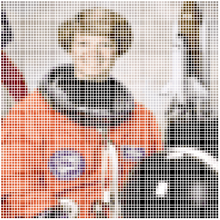
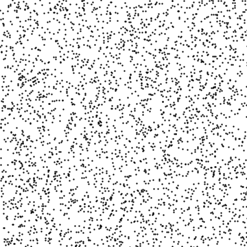
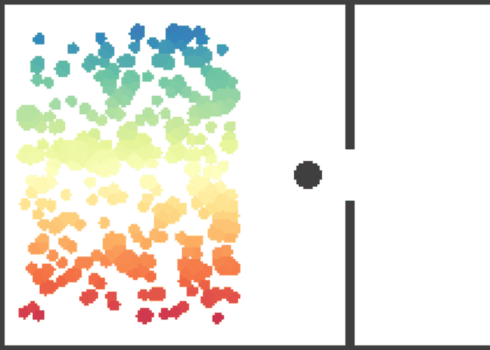
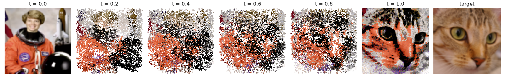
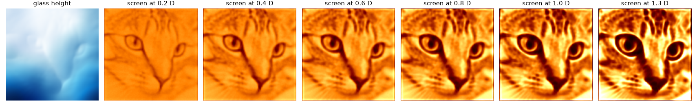
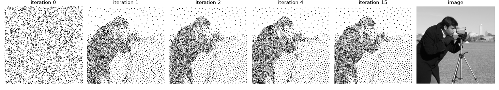
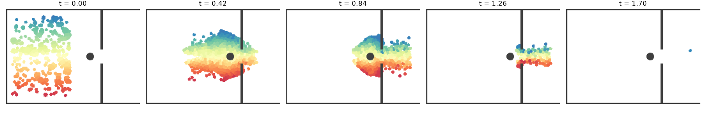

# Optimal transport, MVA

I came to optimal transport through a research project on flow matching for molecular generation.
This repo is my implementation of the course by Gabriel Peyré and Julie Delon ([OT4ML](https://www.gpeyre.com/ot4ml/)), redoing their examples and extending some of them.

## Images and shapes

 


Displacement interpolation from a knight to a queen, exact assignment on 2000 points. The bottom row is the mixture $(1-t)\alpha + t\beta$ of the same two measures.


Entropic barycenters of four silhouettes with bilinear weights, convolutional Sinkhorn on an 80 × 80 grid.


Coffee recolored with the palette of an immunohistochemistry slide. Exact OT between 2000 sampled pixels, extended to the full image, shown at intermediate $t$ with the moving RGB cloud.


Style transfer as an OT map between the VGG features of the two images, decoded at intermediate $t$ with the AdaIN decoder of Huang and Belongie. Rows: diagonal Gaussian map (this is AdaIN), full Gaussian map $T(x) = m_1 + A(x - m_0)$ with the Bures solution for $A$, sliced OT map in the 512 dimensional feature space.

## Playground

   



The astronaut's pixels rearranged into the cat, colors untouched. Exact assignment on RGB plus a small position term, then every pixel flies in a straight line.



A glass slab that draws the cat with sunlight. In the paraxial limit a ray leaving the glass at $x$ hits a screen at distance $sD$ at $(1-s)x + sT(x)$, so the glass height is the Brenier potential of the map from uniform light to the image, up to $|x|^2/2$, and moving the screen is McCann interpolation. Past $D$ the rays cross and caustics appear.



The cameraman drawn with 3000 dots. Each iteration solves the semi discrete problem so that every dot gets the same amount of ink, then moves the dots to the centroids of their Laguerre cells, as in blue noise through OT by de Goes et al.



300 people leaving a room with a pillar in front of the door. At each step everyone walks along the geodesic distance to the exit, then the crowd is projected in $W_2$ onto densities at most 1, which gives each person a Laguerre cell capped by a disc (Leclerc, Mérigot, Santambrogio, Stra). The queue at the door comes from the projection alone.

## Course examples


Assignment on the line: convex cost gives the monotone matching, concave cost gives nested local exchanges.


Histogram equalization as the monotone map $F_\beta^{-1} \circ F_\alpha$, interpolated in $t$.


$W_2$ geodesic between Gaussians against linear interpolation of covariances, which swells in the middle.


Entropic plans for increasing $\varepsilon$ and the linear convergence of log domain Sinkhorn, slower as $\varepsilon$ decreases.


Balanced versus KL unbalanced transport with an outlier cluster. Marker size is the transported mass.


Particle descent on raw entropic OT against the Sinkhorn divergence. With a large blur the raw loss collapses onto a curve inside the target.


Voronoi cells, Laguerre cells with equal masses found by L-BFGS on the semi discrete dual, and Lloyd iterations.


Flow matching towards a queen with independent and minibatch OT couplings. The OT coupling gives straighter paths and usable samples with a single Euler step.


Gradient descent against Langevin dynamics in a double well. Only the second samples $e^{-V}$.

## Structure

```
common.py     glyph rasterization, Laguerre cells, semi discrete solver, gif helper
visual/       mccann_chess, barycenters_chess, color_transfer, style_transfer_latent
playground/   pixel_shuffle, caustic_lens, stippling, crowd_evacuation
course/       matching_1d, histogram_equalization, gaussian_geodesic, sinkhorn_epsilon,
              unbalanced, sinkhorn_debiasing, semidiscrete_lloyd, flow_matching_couplings, langevin
figures/      outputs
```

```
pip install -r requirements.txt
python -m visual.mccann_chess
```

Scripts run from the repo root and write to `figures/`. The style transfer downloads the VGG encoder and decoder weights from the pytorch-AdaIN releases into `weights/` on first run.
