# Optimal transport, MVA

I came to optimal transport through a research project on flow matching for molecular generation.
This repo is my implementation of the course by Gabriel Peyré and Julie Delon ([OT4ML](https://www.gpeyre.com/ot4ml/)), redoing their examples and extending some of them.

## Images and shapes

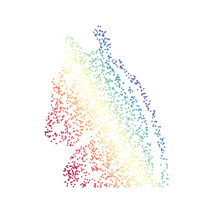 

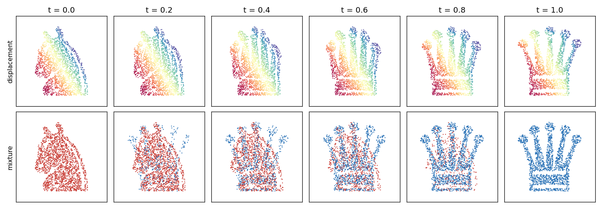

Displacement interpolation from a knight to a queen, exact assignment on 2000 points. The bottom row is the mixture $(1-t)\alpha + t\beta$ of the same two measures.

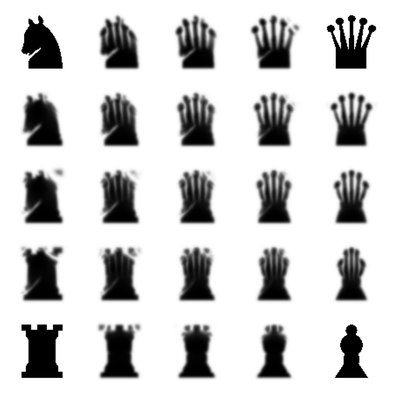

Entropic barycenters of four silhouettes with bilinear weights, convolutional Sinkhorn on an 80 × 80 grid.

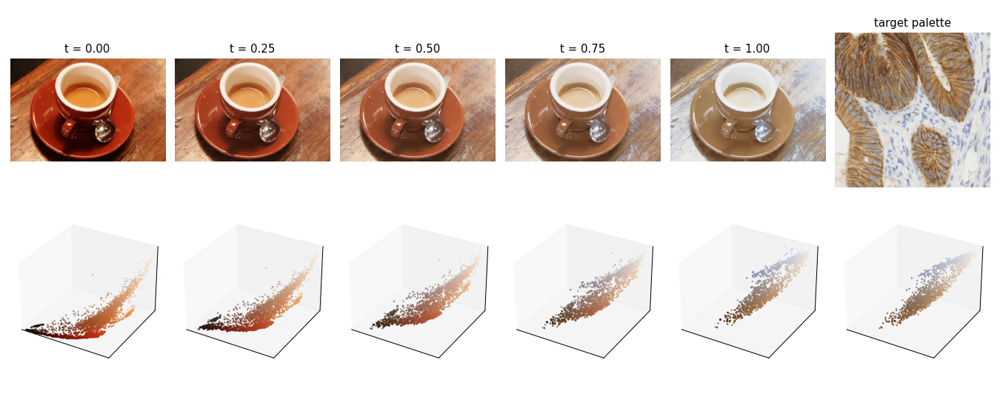

Coffee recolored with the palette of an immunohistochemistry slide. Exact OT between 2000 sampled pixels, extended to the full image, shown at intermediate $t$ with the moving RGB cloud.

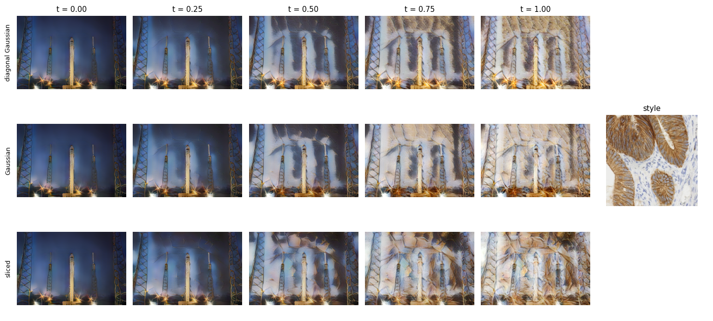

Style transfer as an OT map between the VGG features of the two images, decoded at intermediate $t$ with the AdaIN decoder of Huang and Belongie. Rows: diagonal Gaussian map (this is AdaIN), full Gaussian map $T(x) = m_1 + A(x - m_0)$ with the Bures solution for $A$, sliced OT map in the 512 dimensional feature space.

## Molecules

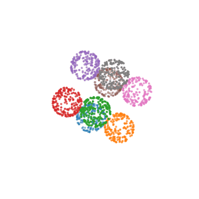 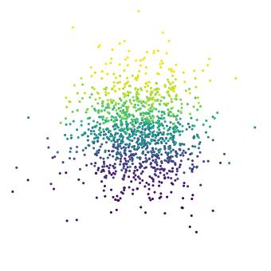

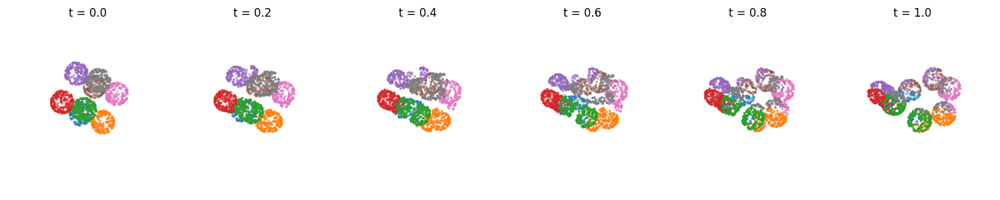

Cubane to cyclooctatetraene, two valence isomers of C8H8. McCann interpolation between points sampled on shrunken carbon spheres after principal axis alignment. Colors follow the eight cubane carbons.

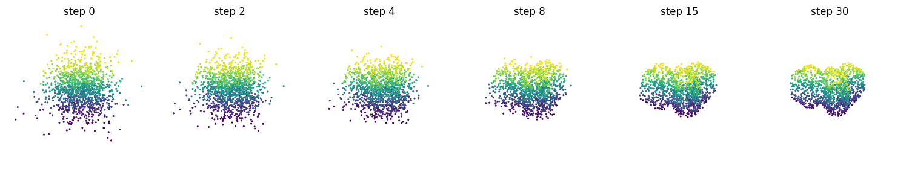

Gaussian noise pushed onto the carbon skeleton surface of triptycene, a three blade paddle, by gradient descent on the Sinkhorn divergence, the particle version of a Sinkhorn generative model.

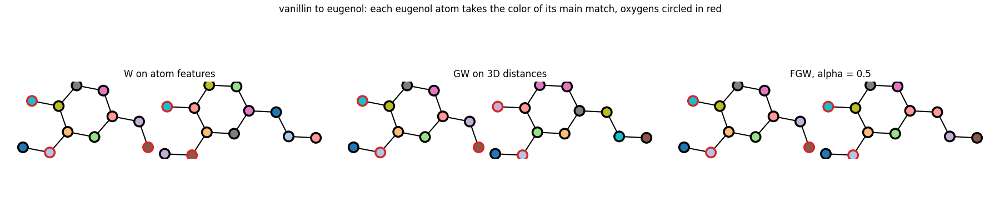

Atom correspondence between vanillin and eugenol. W on element features cannot separate carbons, GW on 3D distance matrices ignores elements, fused Gromov Wasserstein uses both.

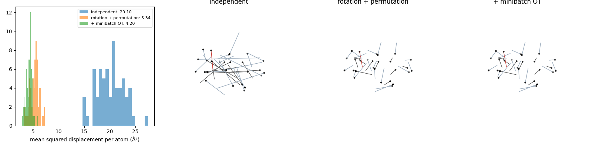

Noise to conformer couplings for 64 linalool conformers, which set how straight flow matching paths are. Mean squared displacement per atom goes from 20.10 Ų with index pairing to 5.34 Ų after Kabsch rotation and per element Hungarian permutation, and to 4.20 Ų with a minibatch OT on top.

## Course examples


Assignment on the line: convex cost gives the monotone matching, concave cost gives nested local exchanges.

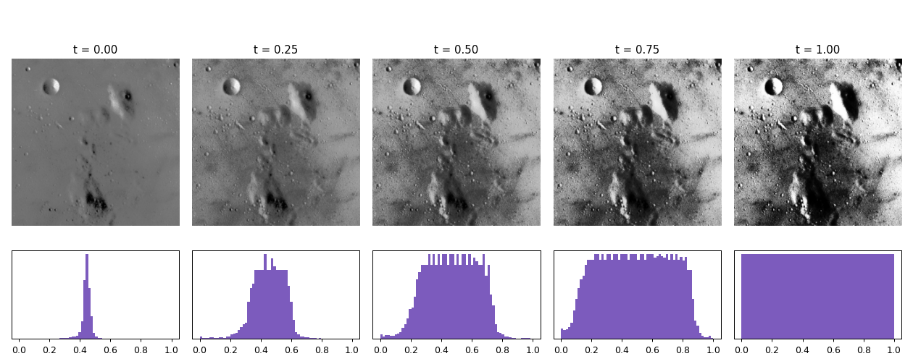

Histogram equalization as the monotone map $F_\beta^{-1} \circ F_\alpha$, interpolated in $t$.

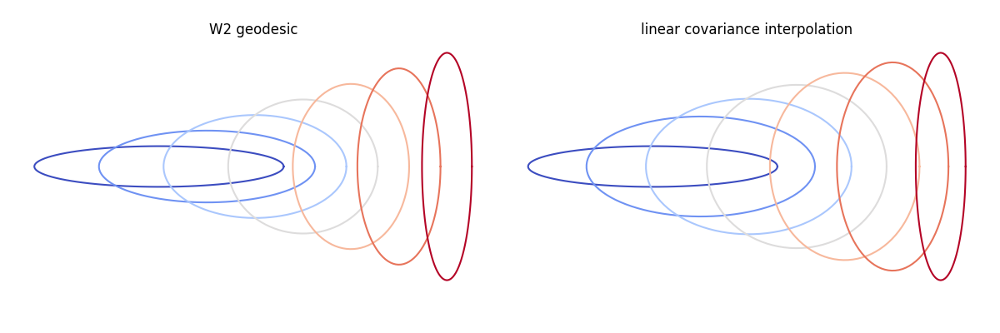

$W_2$ geodesic between Gaussians against linear interpolation of covariances, which swells in the middle.

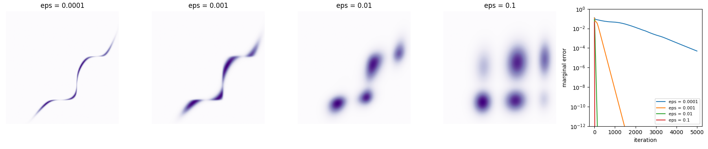

Entropic plans for increasing $\varepsilon$ and the linear convergence of log domain Sinkhorn, slower as $\varepsilon$ decreases.

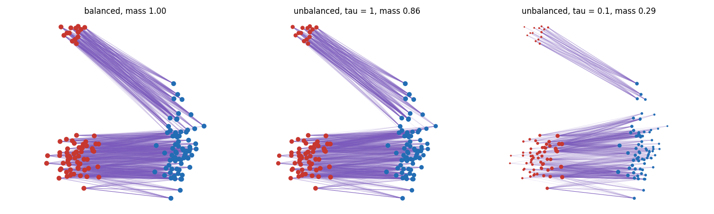

Balanced versus KL unbalanced transport with an outlier cluster. Marker size is the transported mass.

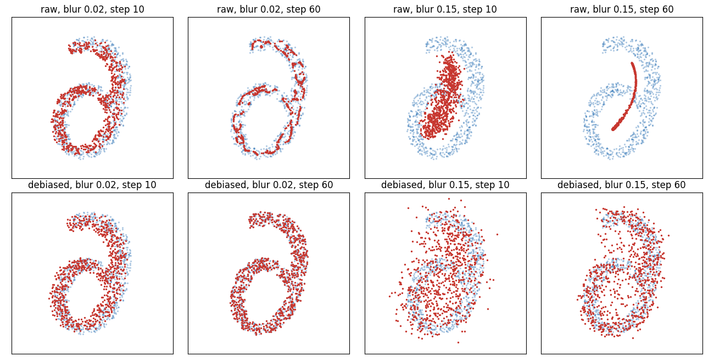

Particle descent on raw entropic OT against the Sinkhorn divergence. With a large blur the raw loss collapses onto a curve inside the target.

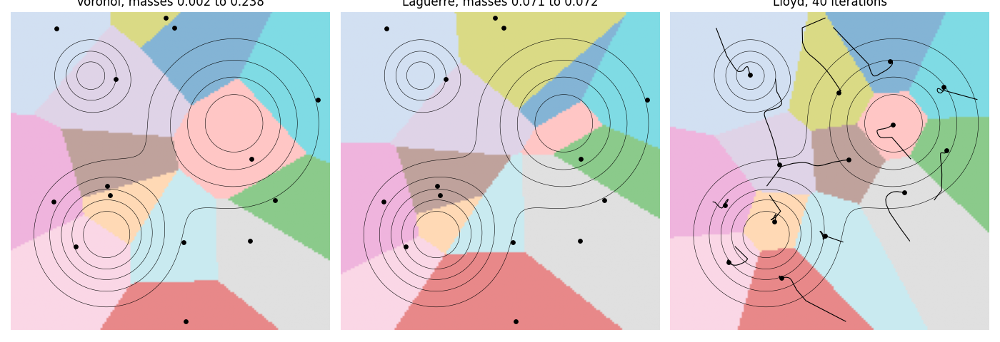

Voronoi cells, Laguerre cells with equal masses found by L-BFGS on the semi discrete dual, and Lloyd iterations.

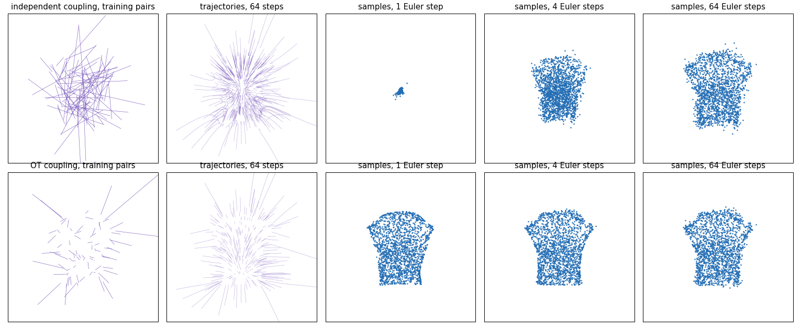

Flow matching towards a queen with independent and minibatch OT couplings. The OT coupling gives straighter paths and usable samples with a single Euler step.

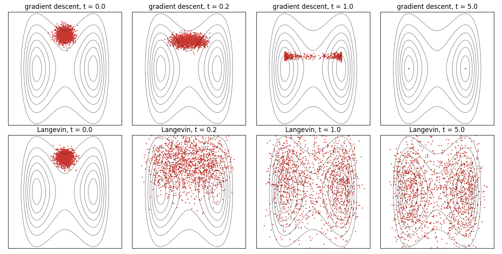

Gradient descent against Langevin dynamics in a double well. Only the second samples $e^{-V}$.

## Structure

```
common.py     glyph rasterization, conformers, surface sampling, gif helper
visual/       mccann_chess, barycenters_chess, color_transfer, style_transfer_latent
molecules/    isomer_surfaces, sinkhorn_flow_surface, fgw_matching, equivariant_coupling
course/       matching_1d, histogram_equalization, gaussian_geodesic, sinkhorn_epsilon,
              unbalanced, sinkhorn_debiasing, semidiscrete_lloyd, flow_matching_couplings, langevin
figures/      outputs
```

```
pip install -r requirements.txt
python -m visual.mccann_chess
```

Scripts run from the repo root and write to `figures/`. The style transfer downloads the VGG encoder and decoder weights from the pytorch-AdaIN releases into `weights/` on first run.
